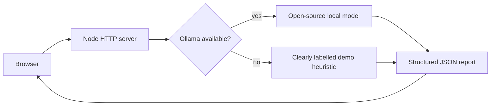

# OpenTrace: Turn noisy logs into your next best move

> Submission draft for the Hacktoberfest Open-Source AI Challenge: Week 4.

## What I built

OpenTrace is a local-first debugging assistant for developers. A user pastes
an error, stack trace, or service log and receives a structured report with a
summary, severity, evidence, likely cause, safe next actions, and questions
that would improve the diagnosis.

**Live demo:** TODO — replace with the healthy Render URL after deployment.

**Source code:** https://github.com/samainakhatun115-cpu/opentrace-ai-debugger

## Why this problem

Logs are often technically detailed but operationally unclear. The final error
message may hide the first useful signal, and a generic chatbot can present a
guess as a fact. OpenTrace makes the distinction visible: evidence is shown
separately from hypotheses, and every response includes safe next steps rather
than destructive commands.

## How open-source AI is used

When Ollama is available, OpenTrace sends the pasted log to a local
Ollama-compatible open-source model and requests a strict JSON report. The
server does not store logs or request history. The model name and endpoint are
configurable through environment variables.

If Ollama is unavailable, OpenTrace uses a deliberately limited heuristic
fallback and labels the result **Demo Mode**. It never presents the fallback
as model output.

## Architecture



## Technical decisions

- **Node.js standard library:** keeps the project easy to inspect and run.
- **Ollama integration:** supports local inference without requiring a hosted
  AI key.
- **Strict JSON output:** gives the UI stable fields and makes uncertainty
  easier to communicate.
- **No persistence:** logs can contain secrets, so OpenTrace does not retain
  them by default.
- **Safe fallback:** the app remains demonstrable without hiding an unavailable
  model dependency.

## What I learned

The most important product decision was not to make the assistant execute
commands. A debugging helper should help a developer decide what to inspect
next, while the developer remains responsible for validating production changes.
Making evidence and limitations visible is more useful than producing a
confident-looking answer.

## Run it locally

```powershell
cd OpenTrace
node server.js
```

Open http://localhost:3000. For model-backed analysis, install Ollama and run:

```powershell
ollama pull llama3.2:3b
```

## Limitations and next steps

- The demo fallback is not a replacement for model inference.
- The tool does not inspect infrastructure or execute commands.
- A future version could add redaction before analysis and adapters for more
  local model runtimes.

## Acknowledgements

Built as a new project for the Hacktoberfest Open-Source AI Challenge: Week 4.
AI assistance was used during development and drafting.
