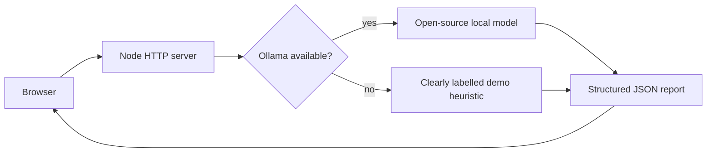

# OpenTrace

> Turn noisy logs into your next best move.

OpenTrace is a local-first debugging assistant for developers. Paste a log or
error and it returns a structured report with a summary, severity, evidence,
likely cause, safe next actions, and questions that would improve the diagnosis.

It uses an open-source model through [Ollama](https://ollama.com/) when
available. If Ollama is unavailable, the app clearly labels its limited
heuristic fallback as **Demo mode** instead of pretending an AI model ran.

## Run locally

Requirements: Node.js 18+ and optionally Ollama.

```powershell
cd OpenTrace
node server.js
```

Open http://localhost:3000.

For local AI analysis, install Ollama, then download a model:

```powershell
ollama pull llama3.2:3b
```

### Deploying a public demo

The repository includes a `render.yaml` blueprint for Render. A public
deployment runs in clearly labelled Demo Mode because Ollama is local to your
machine and is not included in the hosted service. Do not describe the hosted
deployment as local model inference unless you configure a separate hosted
model endpoint.

You can change the model or port:

```powershell
$env:OLLAMA_MODEL = "qwen2.5:3b"
$env:PORT = "3000"
node server.js
```

## Design



Logs are sent only to the local Ollama endpoint configured by `OLLAMA_URL`.
OpenTrace does not store logs or request history. The model can be wrong:
review its evidence and validate suggested actions before changing production.

## Why this is open source

Debugging tools often hide their reasoning behind a hosted API. OpenTrace
keeps the interaction inspectable, runs with an open-source model, and makes
uncertainty visible. The server prompt, fallback behavior, and UI are all
included so contributors can improve the workflow or add model adapters.

## Current limitations

- The fallback is intentionally simple and is not a substitute for a model.
- Ollama must be running locally for real model analysis.
- The app does not execute commands or inspect infrastructure.
- There is no persistent storage by design.

## License

MIT. See [LICENSE](./LICENSE).
